# The prototype's look and feel, set beside the rebuild's

Status: **a draft, `ai-unreviewed`**, written after the human said the behaviour list (`prototype_behaviours.md`) was "mostly functional stuff. I wanted to capture the look and feel of the prototype mostly" (`in_1574`). The pictures are the **running old app** (`app/`, driven with a headless browser) and the **running rebuild** (`next/`, `dev/lookfeel-shots.ts`) in the same states, so the differences are seen and not described from memory. Nothing here is decided; the human marks what to copy.

Pictures: `look/prototype/*.png` (old) and `look/new/*.png` (rebuild), 1100 x 720.

## 1. The ring and the sketch chrome

| Old app | Rebuild |
|---|---|
| 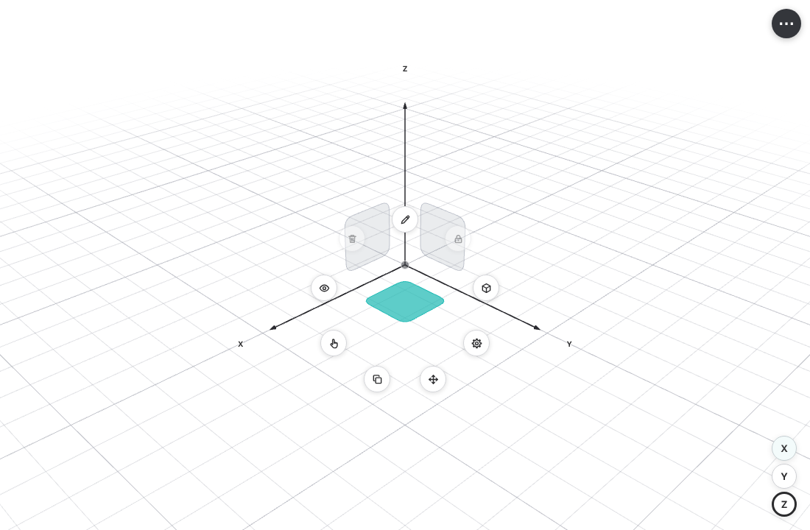 | 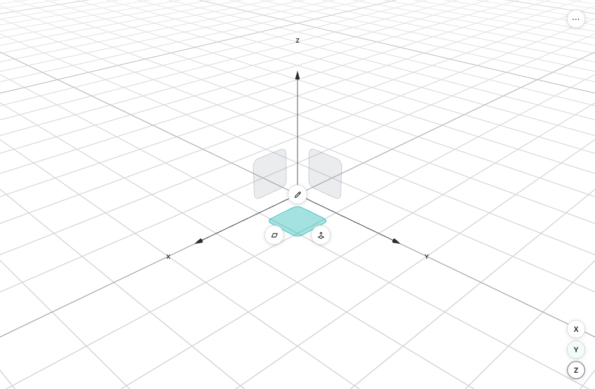 |
| **The ⋯ button is a dark filled circle with white dots**; the ring's round buttons are smaller with a soft shadow, and the ones that cannot be used (bin, lock) are faded, not hidden; the sub-ring for sketch tools sits on the same circle | The ⋯ button is a white circle with grey dots; the ring is the old one (ported) |

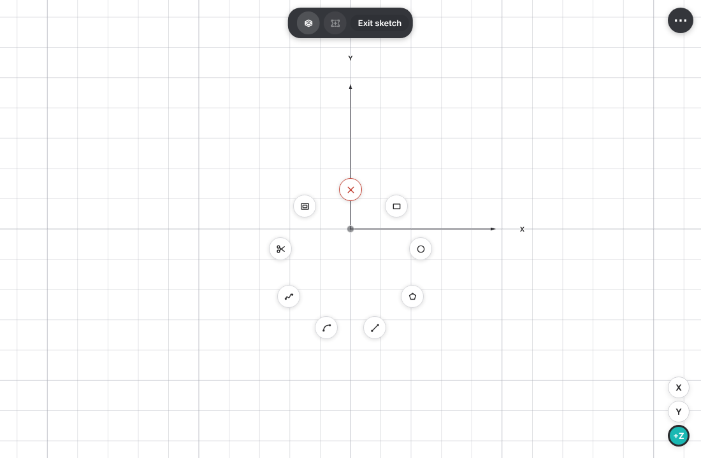

**Choosing the pencil starts sketch mode** in the old app: the view turns straight, the grid is the plane's, and **a dark rounded pill appears at the top centre** with the cut-view toggle, the keep-square toggle and **"Exit sketch"** (and, once a tool is armed, the tool's icon and a cross). The ring's centre becomes a red cross ("Back"). The rebuild has no sketch mode and no pill: the tools just arm.

## 2. Drawing a rectangle

| Old app | Rebuild |
|---|---|
| 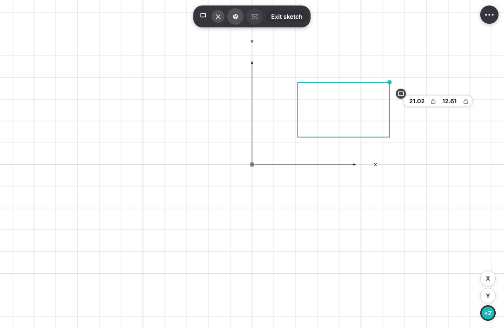 | 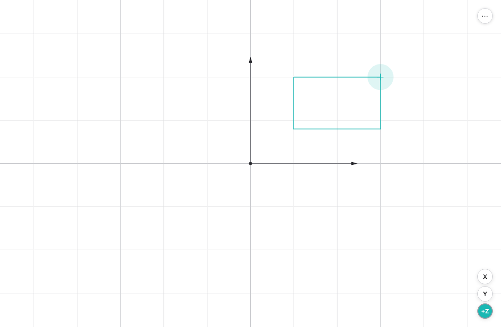 |
| A **teal outline with a solid dot at the pointer corner**; a **small tool badge** follows the pointer; **a pill with the live Width and Height beside it, each with an open padlock** (type to set them); the top pill shows the tool and a cross | A teal outline with a faint cross and the hover disc; no numbers while drawing |

## 3. A drawn line selected, and the bubble

| Old app | Rebuild |
|---|---|
| 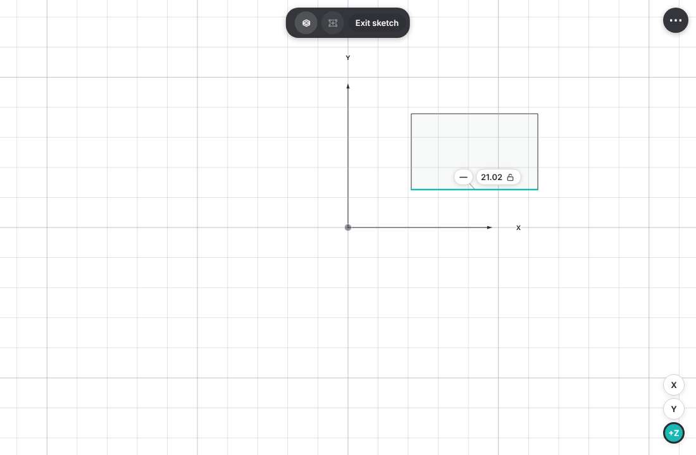 | 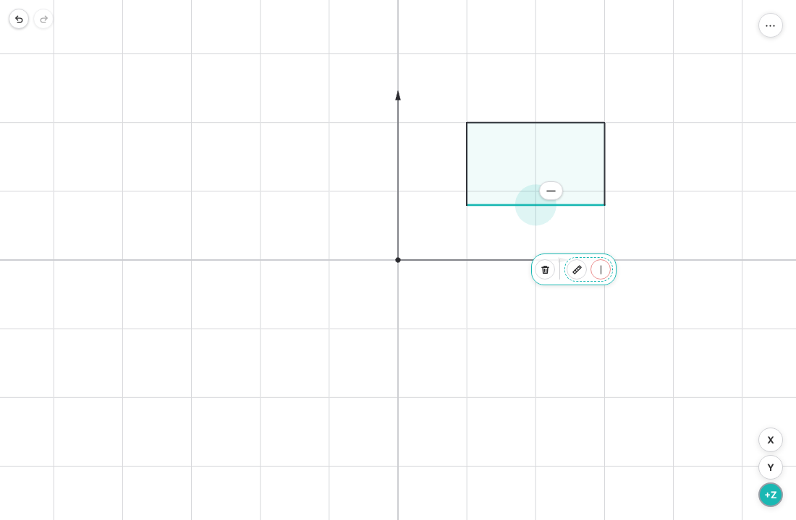 |
| A closed figure has a **very faint tint** (about 6%); the selected line is a **thicker teal line**; **no marks at the points**; two bubbles: "—" (level) and **the measured length "21.02" with an open padlock, with a short leader line to the line**; **no bar** for one line | Points drawn as small ticks; the line is teal; "—" only; **a bar (bin, cross, ruler, upright)** stands up and to the right; a hover disc |

## 4. Two lines selected: the suggestion bar

| Old app | Rebuild |
|---|---|
| 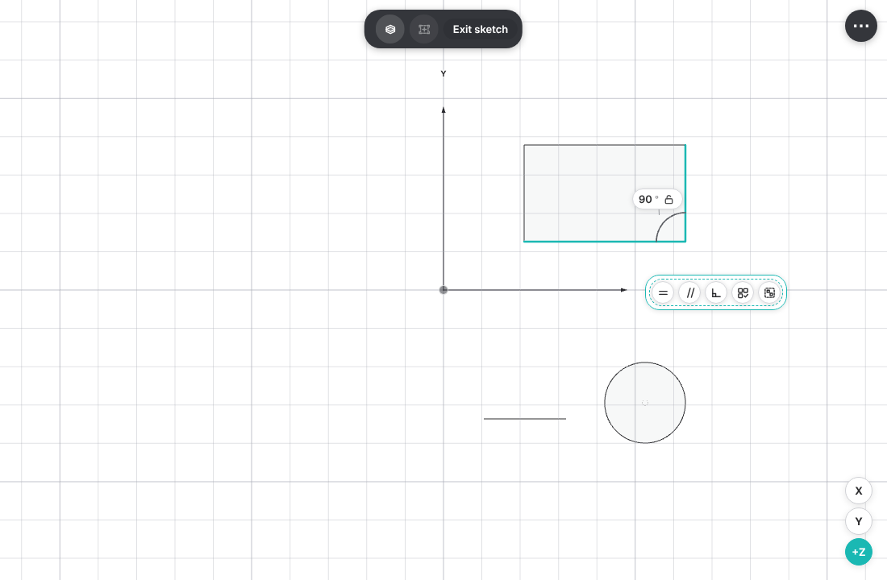 | 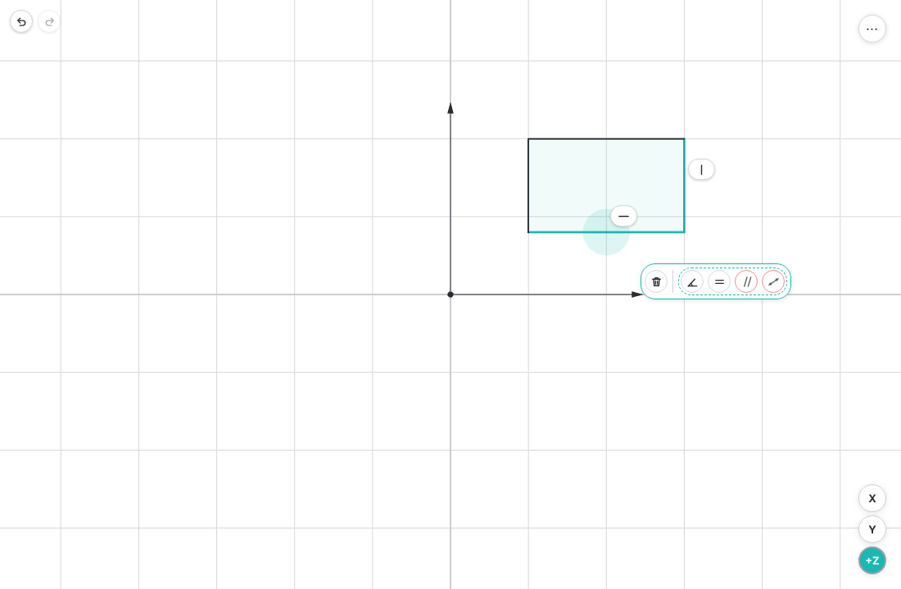 |
| The **bar stands below the lines, to the right, as one rounded capsule with a dashed teal outline** holding round buttons (equal, parallel, square, and two selection tools); **the measured angle "90 °" with its padlock sits on a small arc drawn at the corner** | A white capsule with a divider: bin and cross (left), then the relations (right), the ones that cannot hold in red; no dashed outline; no angle arc; extra "—" and "|" bubbles |

## 5. Drawing a line: the helpers

| Old app | Rebuild |
|---|---|
| 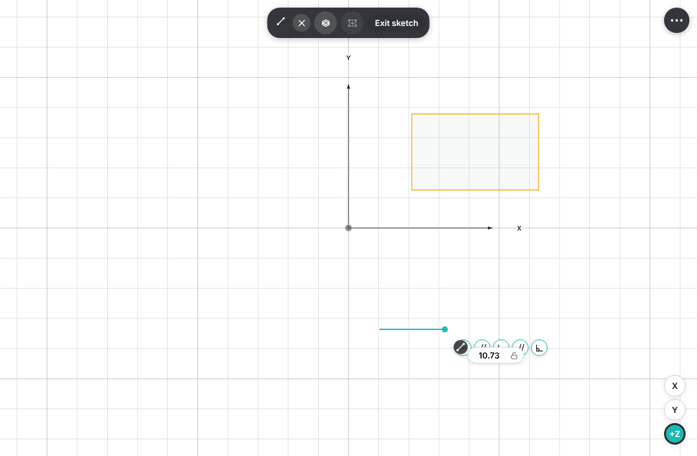 | 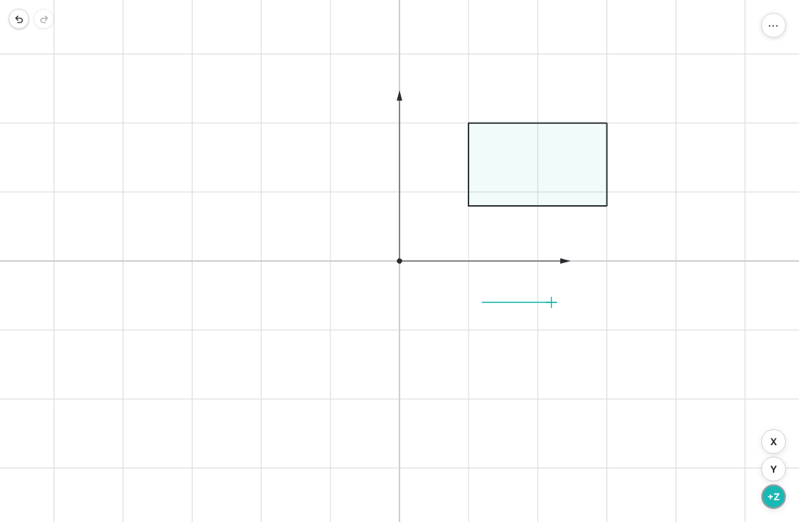 |
| The line is teal with a dot at its end; **a row of small round teal-edged icons beside the end says what the end is lined up with** (parallel, perpendicular, level…) and **the part it is about lights amber (the rectangle)**; the live length "10.73" with a padlock; the pointer's tool badge | The line and a cross; nothing says what it is lined up with |

## 6. A circle

| Old app | Rebuild |
|---|---|
| 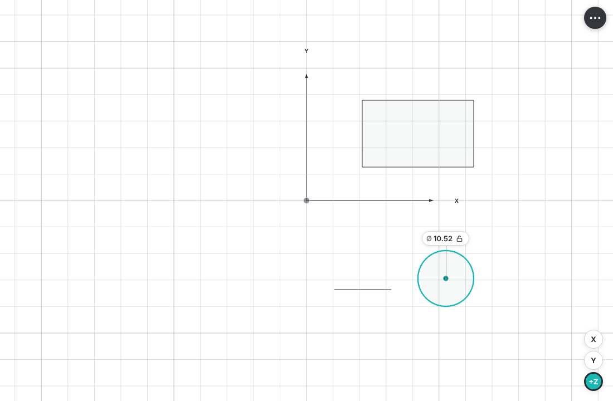 | 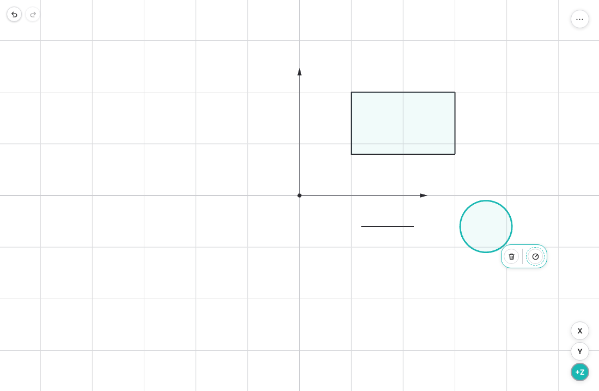 |
| Selected: **teal ring and a teal centre dot**; **"Ø 10.52" with a padlock, a thin leader line down to the centre**; a very faint tint inside | Teal ring; no number until a dimension is added; ticks at the points |

## 7. What the difference comes to

Each item is a look-and-feel piece to **copy** (`keep`), **change** or **drop**; the human marks them.

| # | Piece | Old app | Rebuild now | Weight of work |
|---|---|---|---|---|
| L1 | The dark pill at the top in sketch mode (tool, cross, cut view, keep square, Exit sketch) and sketch mode itself | yes | none | medium (a mode and a pill; the operation bar is the same component) |
| L2 | The ⋯ button as a dark filled circle | yes | white | tiny |
| L3 | The faint tint of a closed figure; no marks at the points; line weights (thin charcoal, thicker teal selected) | yes | ticks at points, no tint | small |
| L4 | Live size pill while drawing: Width and Height / Diameter / Length with padlocks, typed to set | yes | none | medium |
| L5 | The tool badge that follows the pointer | yes | a cross | small |
| L6 | Hint icons beside the end, and the part lit amber while a hint is active; dashed guide lines; place-only (no constraint) | yes | none | medium to large (the snap rules of `hints.ts` are pure and can be ported) |
| L7 | Dimension bubbles: the number with an open or closed padlock, a leader line, the Ø and R marks; the measured number shown at once, locked on a click | yes | a number only after a number is put on; no padlock | medium |
| L8 | The suggestion bar: a capsule with a dashed teal outline, below the selection, relations only on one or two parts, no bar for one line; the angle on an arc at the corner | yes | white capsule with bin and cross, up and right | medium (placement and look are in `ui/suggest.ts`, pure) |
| L9 | Refusals: the culprit constraints flash red and the culprit shakes, a button "Delete constraint to proceed" beside the first red bubble; already holds flashes a mild green; an open bubble lights the parts it ties amber | yes | red flash of the bubbles only | medium |
| L10 | Undo and redo are in the ⋯ list, not round buttons; the step list is the History panel under ⋯ | yes | round buttons and a list always on screen | small to medium (the human asked for the step list; where it lives is open) |

## 8. What the human said (`in_1574`) and what was done

| The human | Done / next |
|---|---|
| "this is mostly functional stuff. I wanted to capture the look and feel" | This document: pictures of both, and the look pieces L1 to L10. The behaviour list stays as the checklist behind it |
| "click starts, second click ends on single line sketching" | **Done.** A line is two clicks; the tool stays armed; a line that ends on a point already drawn goes on from it (the old app's rule) |
| "the helpers help position but don't add constraints" | **Done for clicks and drags:** a click on a line or circle puts the point there and makes no constraint; a point let go on another lands there and makes none (before, both added one). The bar still adds a relation when the person presses it |
| "I am not sure about the grid or how dimensions are handled" | Left **open**: `q_sketch_grid_and_dimensions` |
| "the helper bar is better in the prototype" | To do (L8): port its look and placement |
| "different extrude types … based off how the face should extend … the chamfered block to pyramid example" | To do: see `docs/decisions/dec_edits_saturate.md` (`in_405`) and `engine_requirements.md` E32 (modes Edit, Push, Move, Offset). The engine has them; the screen offers one. To offer **Extrude** (a prism of the face), **Move** (the step that made it changes: grows the height), **Extend** (the face and its neighbours carried on until they meet: the chamfered block to a pyramid) as options in the operation bar |
| "keep the keyboard bindings off for now" | **Done:** the D key for a dimension is gone; undo, redo, Delete and Esc stay (the old app binds the same and no letter keys) |
| "keep the colored on constraints like the original prototype" | Read as the **constraint colours**: amber for the parts a constraint ties, red for the ones that refuse, mild green for one that already holds, teal for selected (the old app has no colour for how constrained a sketch is). To do (L9) |

## 9. Lines, points, bodies and the extrusion (the human's questions, `in_1575`)

**Lines and points: not the same, and now closer.** Old app: thin charcoal lines, **no mark at any point** until it is picked (then a teal ball), the picked line a thicker teal, **a closed figure tinted very faintly (6%)**. Rebuild before this change: a "+" tick at every point and no tint. Done now: the ticks are gone (only a picked point is marked), closed figures carry the faint teal tint (a hole is left out). Not done: the ball for a picked point (a small cross for now), the line weights (the old app's thin charcoal against the rebuild's 2 px), the hover disc that the old app hides while drawing.

**Bodies: not the same, and now the same way made.** Old app: the body has a slight clear coat over the grey, and **its lights ride with the camera** (the key to the left and above it, a weak fill at the eye), so the top that faces the sky is the lightest and the shading is the same from any side; the outline is the dark charcoal. Rebuild before: a flat matte grey with the light at the eye. Done now: the old app's material and lights (settings `light`), the same outline colour. Still a little darker than the old app's top face; the sheen's reflection map is not ported.

**Extrusion: not the same yet.** Old app: picking a closed figure lights **the whole figure teal**, a **small double-headed arrow** stands in its middle (pulled from the middle either way), the number "0" sits as a chip at the figure's edge, and the body that results is the grey one above. Rebuild: a long one-way arrow from the middle with the number at its tip, a teal ghost prism while pulling. To do (L11): the double arrow and the chip's place, the figure lit teal when picked.

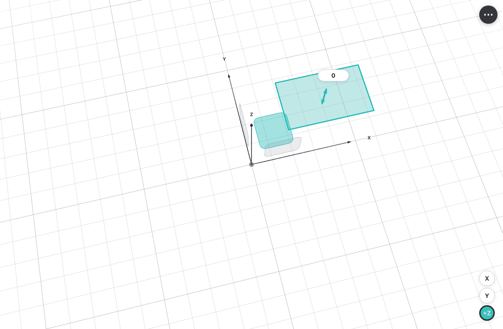
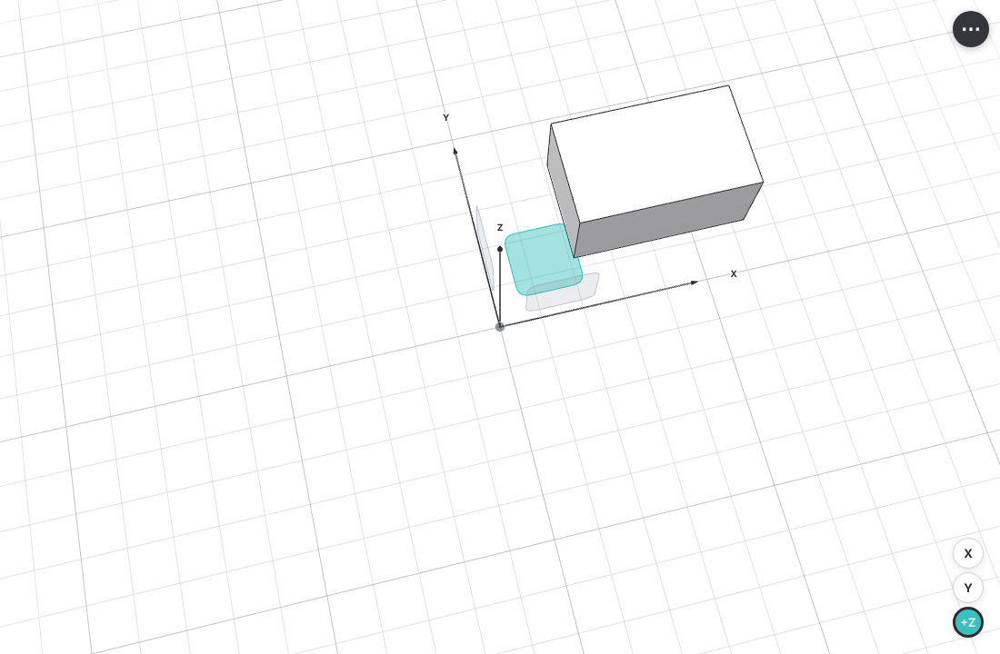

## 10. Face pull kinds (`in_1575`, `dec_edits_saturate`): done

The operation bar of a pulled face now has **Move | Extrude | Extend** (and Offset for a round wall), the kinds the engine has (`pullModes`, E32): **Move** changes the step that made the face (the height grows; what the old app did), **Extrude** adds a prism of the face's outline (the chamfers stay as a ledge), **Extend** moves the face and carries its neighbours on until they meet (the chamfered block towards a pyramid; past the tip it says where they meet, 6.999 mm on the human's 20 x 20 x 10 block with 3 mm chamfers, and makes nothing different). The first that applies is chosen at the start (Move when a step made the face). `dev/pullmodes-check.ts` (the kernel) and `dev/pullkinds-browser.ts` (the page) check all three on that block.

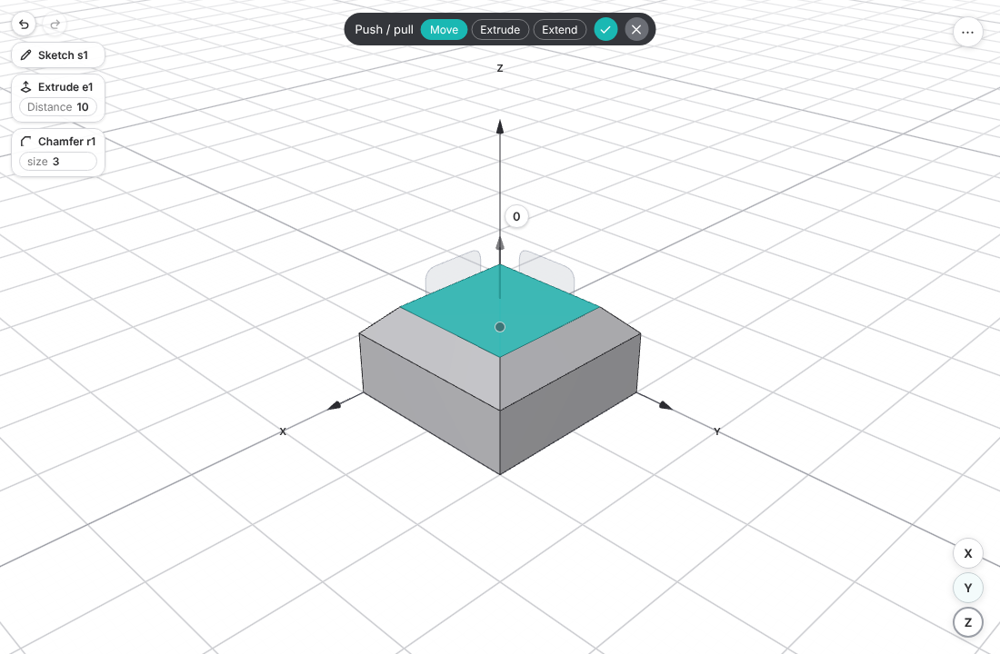
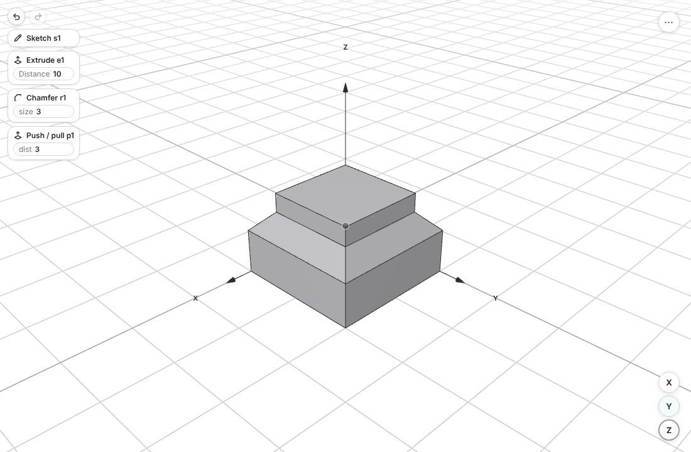

## 11. The helper bar (`in_1574`, `in_1575`): done

Same look (a rounded white row with a teal edge, the suggested relations in a dashed teal outline of their own, round 28 px buttons) and **the same place** (67 px below the middle of what is selected, 6 px to its left; above it when there is no room). The delete button is on the left; a click on nothing puts the pick away (no cross).
